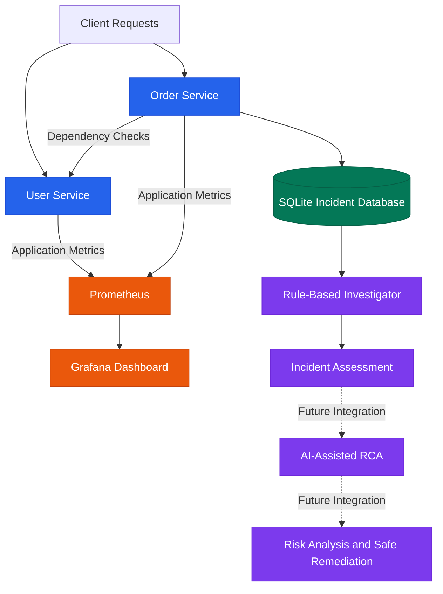
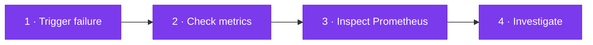

<div align="center">


### 🔎 AI-Powered Production Incident Root-Cause & Change-Risk Analysis Platform

**From production failures to evidence-backed root-cause analysis.**

<br/>


<br/>

[**Overview**](#-overview) •
[**Problem**](#-the-problem) •
[**Features**](#-features) •
[**Architecture**](#%EF%B8%8F-architecture) •
[**Quick Start**](#-quick-start) •
[**Demo**](#-try-it-simulate-an-incident) •
[**Roadmap**](#%EF%B8%8F-roadmap)

</div>

<br/>

## 💡 Overview

**RootLens** is a production reliability and incident investigation platform that helps engineers understand not only *what failed*, but also ***why* it failed**.

Traditional monitoring tools show metrics and alerts. RootLens connects **observability data**, **service dependencies**, **incident history**, and **deployment changes** to:

| | |
|---|---|
| 🎯 **Identify** | likely root causes |
| 🧾 **Explain** | the supporting evidence |
| 💥 **Assess** | potential downstream impact |
| 🛟 **Recommend** | safe recovery actions |

> [!NOTE]
> RootLens is being built incrementally, starting with a containerized microservice environment and progressing toward evidence-driven, AI-assisted incident analysis.

<br/>

## 🎯 The Problem

When a production service fails, engineers often have to investigate several sources independently:

| Signal | What engineers hunt for |
|:---:|---|
| 📉 | Metrics and abnormal request patterns |
| 📋 | Application errors and incident history |
| 🔗 | Dependencies between microservices |
| 🚀 | Recent deployments and configuration changes |
| ⚠️ | Potential impact on downstream services |

**RootLens brings these signals together into a single investigation workflow.**

<br/>

## ✨ Features

### ✅ Implemented

| | Feature | Description |
|:---:|---|---|
| 🧩 | **Microservice environment** | Separate User Service and Order Service built with FastAPI |
| 💚 | **Health monitoring** | Health endpoints for checking service availability |
| 💣 | **Failure simulation** | Intentionally trigger a User Service failure to test incident investigation |
| 📈 | **Prometheus metrics** | Application request counters exposed through `/metrics` |
| 🛰️ | **Centralized collection** | Prometheus scrapes metrics from both microservices |
| 📊 | **Grafana integration** | Grafana running with a Prometheus data source configured |
| 💾 | **Incident persistence** | Incident records stored in SQLite on a persistent Docker volume |
| 🧠 | **Rule-based investigation** | Recorded incidents analyzed with predefined rules for a preliminary root-cause assessment |
| 🐳 | **Docker Compose** | Services and monitoring components run together with one command |

### 🚧 Planned

<details>
<summary><b>Click to expand the planned feature set</b></summary>

<br/>

- 🔭 OpenTelemetry-based distributed tracing and richer telemetry correlation
- 🤖 Automated anomaly detection using statistical and machine-learning techniques
- 🕸️ Service dependency graphs and blast-radius analysis
- 🔀 Correlation of incidents with deployment and configuration changes
- 💬 LLM-assisted root-cause explanations grounded in collected evidence
- 🧮 Change-risk scoring for proposed fixes and deployments
- 🛡️ Policy-controlled remediation with allowlisted actions
- ✔️ Post-remediation health checks and recovery verification
- 📜 Audit logs, escalation workflows, and Kubernetes integration

</details>

> [!IMPORTANT]
> **Design principle:** *Evidence before conclusions. Safe, verifiable actions before automated remediation.*

<br/>

## 🏗️ Architecture



<sub>Solid lines show the current core architecture; dashed lines show planned extensions.</sub>

<br/>

## 🛠️ Technology Stack

| Category | Technologies |
|:---|:---|
| 🐍 **Language** | Python |
| ⚡ **API framework** | FastAPI |
| 🧩 **Microservices** | User Service, Order Service |
| 🐳 **Containerization** | Docker, Docker Compose |
| 📈 **Metrics collection** | Prometheus |
| 📊 **Visualization** | Grafana |
| 💾 **Incident storage** | SQLite |
| 🌐 **HTTP communication** | HTTPX |
| 🔭 **Planned observability** | OpenTelemetry |
| 🧠 **Planned analysis** | Statistical ML, graph analysis, LLM-assisted reasoning |
| ☸️ **Planned orchestration** | Kubernetes |

<br/>

## 📁 Project Structure

```text
RootLens/
├── 📄 compose.yaml
├── 📄 README.md
├── 📄 .gitignore
│
├── 👤 user-service/
│   ├── Dockerfile
│   ├── app.py
│   └── requirements.txt
│
├── 🛒 order-service/
│   ├── Dockerfile
│   ├── app.py
│   ├── database.py
│   ├── investigator.py
│   └── requirements.txt
│
└── 📈 prometheus/
    └── prometheus.yml
```

<br/>

## 🚀 Quick Start

### Prerequisites

- [Git](https://git-scm.com/)
- [Docker Desktop](https://www.docker.com/products/docker-desktop/) with the Docker engine running
- A modern web browser

### 1️⃣ Clone the repository

```bash
git clone https://github.com/HemashreeVI/RootLens.git
cd RootLens
```

### 2️⃣ Start the platform

```bash
docker compose up --build -d
```

Docker builds the application images and starts the microservices, Prometheus, and Grafana.

### 3️⃣ Verify running containers

```bash
docker compose ps
```

### 4️⃣ Open the services

| Component | URL |
|:---|:---|
| 👤 User Service | http://localhost:8001 |
| 💚 User Service Health | http://localhost:8001/health |
| 📈 User Service Metrics | http://localhost:8001/metrics |
| 🛒 Order Service | http://localhost:8002 |
| 💚 Order Service Health | http://localhost:8002/health |
| 🔗 Dependency Check | http://localhost:8002/check-user-service |
| 📋 Incident History | http://localhost:8002/incidents |
| 📈 Order Service Metrics | http://localhost:8002/metrics |
| 🔥 Prometheus | http://localhost:9090 |
| 🎯 Prometheus Targets | http://localhost:9090/targets |
| 📊 Grafana | http://localhost:3000 |

> [!TIP]
> Grafana dashboards may require additional configuration.

<br/>

## 🧪 Try It: Simulate an Incident

RootLens includes a controlled endpoint for simulating a User Service failure. Follow the flow below:



#### 💣 Step 1 — Trigger a simulated failure

```text
http://localhost:8001/simulate-failure
```

The endpoint intentionally returns an HTTP `503 Service Unavailable` response.

#### 📈 Step 2 — Check application metrics

```text
http://localhost:8001/metrics
```

Look for the custom request counter:

```text
rootlens_user_requests_total
```

#### 🔥 Step 3 — Inspect Prometheus

```text
http://localhost:9090/targets
```

Confirm that the User Service and Order Service targets are **up**. You can also query the metric:

```promql
rootlens_user_requests_total
```

#### 🕵️ Step 4 — Investigate the incident

Check the incident history:

```text
http://localhost:8002/incidents
```

Use the incident ID returned by the API to investigate the recorded incident:

```text
http://localhost:8002/investigate/YOUR_INCIDENT_ID
```

> [!NOTE]
> The current investigator uses predefined rules to produce a preliminary assessment. More advanced evidence correlation and automated root-cause analysis are planned.

<br/>

## 🔐 Reliability & Safety Principles

RootLens is designed around these principles:

| | Principle | What it means |
|:---:|---|---|
| 🧾 | **Evidence-based reasoning** | Findings should be supported by observable signals |
| 🎚️ | **Confidence-aware analysis** | Uncertain conclusions are flagged rather than presented as facts |
| 🔑 | **Least privilege** | Automated actions get only the permissions they need |
| 📜 | **Policy-controlled remediation** | Only explicitly permitted actions are eligible for execution |
| ✔️ | **Recovery verification** | A fix is not successful until service health is checked |
| 🔍 | **Auditability** | Investigations and remediation decisions are traceable |
| 🙋 | **Human escalation** | Uncertain or high-risk situations are escalated, not handled recklessly |

<br/>

## 🗺️ Roadmap


```text
[██████████████░░░░░░░░░░░░░░░░░░]  7 of 16 milestones complete
```

**Foundation** ✅

- [x] Build the initial FastAPI microservices
- [x] Containerize services using Docker
- [x] Expose custom Prometheus metrics
- [x] Configure Prometheus scraping
- [x] Connect Grafana to Prometheus
- [x] Persist incident records in SQLite
- [x] Implement preliminary rule-based investigation

**Next up** 🚧

- [ ] Complete the Grafana observability dashboard
- [ ] Integrate OpenTelemetry tracing
- [ ] Correlate metrics, traces, logs, and incidents
- [ ] Build service dependency and blast-radius analysis
- [ ] Implement anomaly detection
- [ ] Add evidence-grounded AI root-cause explanations
- [ ] Introduce change-risk assessment
- [ ] Implement policy-controlled remediation and recovery verification
- [ ] Extend deployment to Kubernetes

<br/>

## 📊 Current Status

| | |
|:---|:---|
| **Stage** | Observability foundation and preliminary incident investigation |
| **Working today** | Containerized environment, application metrics, persistent incident storage, rule-based incident assessment |
| **In development** | AI-assisted root-cause analysis and safe-remediation workflow |

<br/>

## 👩‍💻 Author

<div align="center">

**Hemashree V. I.**

B.Tech — Computer Science and Engineering, Cyber-Physical Systems
VIT Chennai

[](https://github.com/HemashreeVI)

<br/>

⭐ *If you find RootLens interesting, consider giving it a star!* ⭐


**RootLens — Observe the failure. Understand the cause. Verify the recovery.**

</div>
