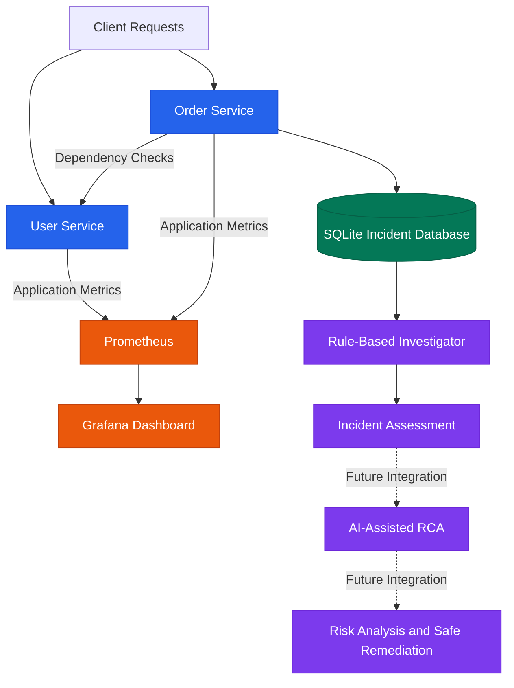

# 🔎 RootLens
### AI-Powered Production Incident Root-Cause & Change-Risk Analysis Platform

<p align="center">
  <b>From production failures to evidence-backed root-cause analysis.</b>
</p>

<p align="center">
  
  
  
  
  
</p>

---

## 💡 Overview

**RootLens** is a production reliability and incident investigation platform designed to help engineers understand not only *what failed*, but also *why it failed*.

Traditional monitoring tools show metrics and alerts. RootLens aims to connect observability data, service dependencies, incident history, and deployment changes to identify likely root causes, explain supporting evidence, assess potential impact, and recommend safe recovery actions.

The project is being developed incrementally, starting with a containerized microservice environment and progressing toward evidence-driven, AI-assisted incident analysis.

## 🎯 The Problem

When a production service fails, engineers often need to investigate several sources independently:

- 📉 Metrics and abnormal request patterns
- 📋 Application errors and incident history
- 🔗 Dependencies between microservices
- 🚀 Recent deployments and configuration changes
- ⚠️ Potential impact on downstream services

RootLens aims to bring these signals together into a single investigation workflow.

## ✨ Key Features

### ✅ Implemented

- **Microservice environment:** Separate User Service and Order Service built with FastAPI.
- **Health monitoring:** Health endpoints for checking service availability.
- **Failure simulation:** Intentionally trigger a User Service failure to test incident investigation.
- **Prometheus metrics:** Expose application request counters through `/metrics`.
- **Centralized metrics collection:** Prometheus scrapes metrics from both microservices.
- **Grafana integration:** Grafana is running with a Prometheus data source configured.
- **Incident persistence:** Store incident records in SQLite using a persistent Docker volume.
- **Rule-based investigation:** Analyze recorded incidents using predefined rules and return a preliminary root-cause assessment.
- **Docker Compose:** Run the services and monitoring components together.

### 🚧 Planned Features

- OpenTelemetry-based distributed tracing and richer telemetry correlation.
- Automated anomaly detection using statistical and machine-learning techniques.
- Service dependency graphs and blast-radius analysis.
- Correlation of incidents with deployment and configuration changes.
- LLM-assisted root-cause explanations grounded in collected evidence.
- Change-risk scoring for proposed fixes and deployments.
- Policy-controlled remediation with allowlisted actions.
- Post-remediation health checks and recovery verification.
- Audit logs, escalation workflows, and Kubernetes integration.

> **Design principle:** Evidence before conclusions. Safe, verifiable actions before automated remediation.

## 🏗️ Architecture



*The solid connections represent the current core architecture; dashed connections represent planned extensions.*

## 🛠️ Technology Stack

| Category | Technologies |
|---|---|
| Programming language | Python |
| API framework | FastAPI |
| Microservices | User Service, Order Service |
| Containerization | Docker, Docker Compose |
| Metrics collection | Prometheus |
| Visualization | Grafana |
| Incident storage | SQLite |
| HTTP communication | HTTPX |
| Planned observability | OpenTelemetry |
| Planned analysis | Statistical ML, graph analysis, LLM-assisted reasoning |
| Planned orchestration | Kubernetes |

## 📁 Project Structure

```text
RootLens/
├── .gitignore
├── compose.yaml
├── README.md
│
├── user-service/
│   ├── Dockerfile
│   ├── app.py
│   └── requirements.txt
│
├── order-service/
│   ├── Dockerfile
│   ├── app.py
│   ├── database.py
│   ├── investigator.py
│   └── requirements.txt
│
└── prometheus/
    └── prometheus.yml
```

## 🚀 Getting Started

### Prerequisites

Install the following:

- [Git](https://git-scm.com/)
- [Docker Desktop](https://www.docker.com/products/docker-desktop/) with the Docker engine running
- A modern web browser

### 1. Clone the repository

```bash
git clone https://github.com/HemashreeVI/RootLens.git
cd RootLens
```

### 2. Start the platform

```bash
docker compose up --build -d
```

Docker builds the application images and starts the microservices, Prometheus, and Grafana.

### 3. Verify running containers

```bash
docker compose ps
```

### 4. Open the services

| Component | URL |
|---|---|
| User Service | http://localhost:8001 |
| User Service Health | http://localhost:8001/health |
| User Service Metrics | http://localhost:8001/metrics |
| Order Service | http://localhost:8002 |
| Order Service Health | http://localhost:8002/health |
| Dependency Check | http://localhost:8002/check-user-service |
| Incident History | http://localhost:8002/incidents |
| Order Service Metrics | http://localhost:8002/metrics |
| Prometheus | http://localhost:9090 |
| Prometheus Targets | http://localhost:9090/targets |
| Grafana | http://localhost:3000 |

*Grafana dashboards may require additional configuration.*

## 🧪 Test Failure Detection

RootLens includes a controlled endpoint for simulating a User Service failure.

### Step 1: Trigger a simulated failure

Open:

```text
http://localhost:8001/simulate-failure
```

The endpoint intentionally returns an HTTP `503 Service Unavailable` response.

### Step 2: Check application metrics

Open:

```text
http://localhost:8001/metrics
```

Look for the custom request counter:

```text
rootlens_user_requests_total
```

### Step 3: Inspect Prometheus

Navigate to:

```text
http://localhost:9090/targets
```

Confirm that the User Service and Order Service targets are up.

You can also query the metric:

```promql
rootlens_user_requests_total
```

### Step 4: Investigate the incident

Check the incident history:

```text
http://localhost:8002/incidents
```

Use the incident ID returned by the API to investigate the recorded incident:

```text
http://localhost:8002/investigate/YOUR_INCIDENT_ID
```

The current investigator uses predefined rules to produce a preliminary assessment. More advanced evidence correlation and automated root-cause analysis are planned.

## 🔐 Reliability and Safety Principles

RootLens is being designed around the following principles:

- **Evidence-based reasoning:** Findings should be supported by observable signals.
- **Confidence-aware analysis:** Uncertain conclusions should be identified rather than presented as facts.
- **Least privilege:** Automated actions must have only the permissions they need.
- **Policy-controlled remediation:** Only explicitly permitted actions should be eligible for execution.
- **Recovery verification:** An attempted fix is not successful until service health is checked.
- **Auditability:** Investigations and remediation decisions should be traceable.
- **Human escalation:** Uncertain or high-risk situations should be escalated rather than handled recklessly.

## 🗺️ Development Roadmap

- [x] Build the initial FastAPI microservices
- [x] Containerize services using Docker
- [x] Expose custom Prometheus metrics
- [x] Configure Prometheus scraping
- [x] Connect Grafana to Prometheus
- [x] Persist incident records in SQLite
- [x] Implement preliminary rule-based investigation
- [ ] Complete the Grafana observability dashboard
- [ ] Integrate OpenTelemetry tracing
- [ ] Correlate metrics, traces, logs, and incidents
- [ ] Build service dependency and blast-radius analysis
- [ ] Implement anomaly detection
- [ ] Add evidence-grounded AI root-cause explanations
- [ ] Introduce change-risk assessment
- [ ] Implement policy-controlled remediation and recovery verification
- [ ] Extend deployment to Kubernetes

## 📊 Current Project Status

**Stage:** Observability foundation and preliminary incident investigation.

The current version provides a working containerized environment, application metrics, persistent incident storage, and rule-based incident assessment. The broader AI-assisted root-cause analysis and safe-remediation workflow remains under development.

## 👩‍💻 Author

**Hemashree V. I.**

B.Tech — Computer Science and Engineering, Cyber-Physical Systems

VIT Chennai

GitHub: [@HemashreeVI](https://github.com/HemashreeVI)

---

<p align="center">
  <b>RootLens — Observe the failure. Understand the cause. Verify the recovery.</b>
</p>
