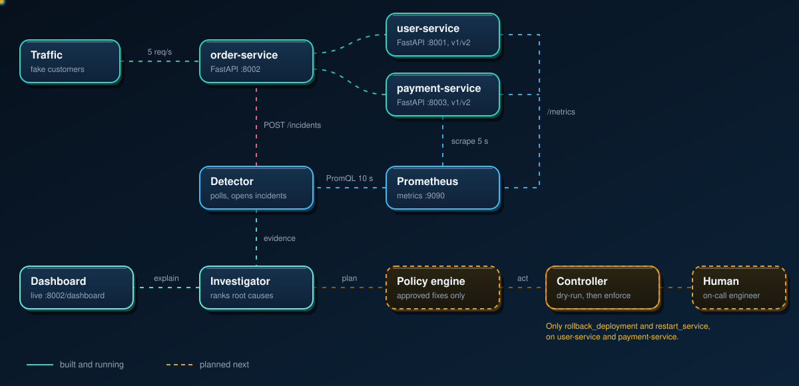
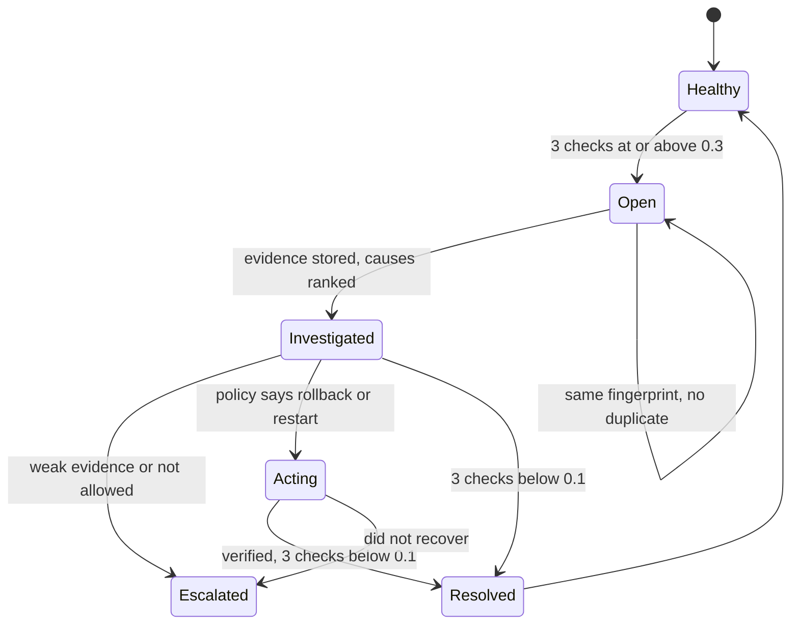

<p align="center">
  
</p>

<p align="center">
       
</p>














## Architecture

<p align="center">
  
</p>

| Component | Port | Role |
|---|---|---|
| `user-service` | 8001 | FastAPI. Chaos switches for errors and latency. Release `v2` has a planted 4 s latency bug. |
| `order-service` | 8002 | FastAPI. Calls user then payment (3 s timeout each). Also hosts incidents, deployments, the investigator and the dashboard. |
| `payment-service` | 8003 | FastAPI. Same pattern. Release `v2` has a planted 50% error bug. |
| `detector` | none | Polls Prometheus every 10 s. Opens an incident after 3 checks at or above 0.3 failure ratio, resolves after 3 checks below 0.1. |
| `controller` | none | The "robot". Reads each open incident, asks the rulebook what to do, and in enforce mode acts, verifies and records. Sends Telegram notices to the service owner. |
| `prometheus` | 9090 | Scrapes all three services every 5 s. |
| `grafana` | 3000 | "RootLens Observability Dashboard". |
| `jaeger` | 16686 | Distributed tracing. The three services send OpenTelemetry traces, so one slow order can be followed across every service. |
| SQLite | volume | `/data/incidents.db` in the `rootlens-data` volume. Holds incidents, deployments and the audit log. |


## Incident lifecycle




## Quick start

You need Docker Desktop (WSL2), Git, Python 3 and PowerShell.

```powershell
git clone https://github.com/HemashreeVI/RootLens.git
cd RootLens
docker compose up -d
docker compose ps
```

You should see 8 containers running. Then open:

| What | URL |
|---|---|
| Live incident dashboard | http://localhost:8002/dashboard |
| Prometheus | http://localhost:9090 |
| Grafana | http://localhost:3000 |
| Jaeger (traces) | http://localhost:16686 |

> Never run `docker compose down -v`. It deletes the incident database volume.


## Try it: the failure lab

Use three terminals from the project root.

```powershell
# Terminal 1: watch the detector
docker compose logs -f detector

# Terminal 2: send fake customer traffic (about 5 requests per second)
python .\traffic.py

# Terminal 3: break something
Invoke-RestMethod -Method Post "http://localhost:8003/chaos/errors?rate=0.5"
```

Watch the dashboard. An incident opens after about 30 seconds. Then reset:

```powershell
Invoke-RestMethod -Method Post "http://localhost:8003/chaos/reset"
```

The detector log prints `RESOLVE incident` once traffic has been healthy for 3 checks. Wait about a minute before the next test so the 1-minute metrics window clears.


## Try it: bad release and rollback

Each service reads `SERVICE_VERSION` and exposes `/version`. Only `v2` contains a bug.

```powershell
.\deploy.ps1 payment-service v2   # bad release: 50% errors, incident opens
.\deploy.ps1 payment-service v1   # rollback: incident resolves
```

`deploy.ps1` updates `.env`, recreates only that container, waits for `/version`, then records the deployment through `POST /deployments`. If PowerShell blocks the script:

```powershell
powershell -ExecutionPolicy Bypass -File .\deploy.ps1 payment-service v2
```


## Try it: let the robot fix it

The controller starts in `dry-run`: it decides and records, but never acts. To let it act, set the mode and recreate it:

```powershell
# in .env
CONTROLLER_MODE=enforce

docker compose up -d controller
.\deploy.ps1 payment-service v2      # ship the bad release
docker compose logs -f controller    # watch it decide, roll back to v1 and verify
```

Every step appears in the dashboard's audit log, including the times it chose **not** to act. Set it back to `dry-run` when you are done.


## Tests and CI

```powershell
python .\order-service\test_investigator.py
python .\controller\test_policy.py
python .\controller\test_safety.py
```

118 unit tests across six files cover the investigator, the rulebook, the safety checks, the executor, the controller loop and notifications. The rulebook and safety checks are pure functions with no Docker or network access, so every rule can be tested on its own. GitHub Actions runs two jobs on every push: `test` runs all six test files, and `build` validates the compose file and builds every image.


## Project layout

```
RootLens/
├── logo.svg, banner.svg, architecture.svg   images used by this README
├── user-service/            FastAPI service with chaos switches
├── payment-service/         FastAPI service with chaos switches
├── order-service/
│   ├── app.py               API, incidents, deployments
│   ├── database.py          SQLite access
│   ├── investigator.py      root-cause ranking
│   ├── dashboard.py         live HTML dashboard
│   └── test_investigator.py unit tests
├── detector/                polls Prometheus, opens and resolves incidents
├── controller/
│   ├── policy.py            the rulebook: act or escalate (decides only)
│   ├── safety.py            pre-flight checks and recovery verification
│   ├── executor.py          the only code that changes the running system
│   ├── controller.py        the loop: decide, check, act, verify, record
│   ├── notify.py            Telegram notices to service owners
│   └── test_*.py            unit tests
├── prometheus/prometheus.yml
├── compose.yaml
├── traffic.py               fake customers
├── deploy.ps1               versioned deploy and rollback
└── .github/workflows/ci.yml
```


## Roadmap

- [x] Three FastAPI services with Docker Compose
- [x] Prometheus and Grafana
- [x] Incident database with open and resolve lifecycle
- [x] Failure lab (chaos switches)
- [x] Continuous detector with evidence collection
- [x] Multi-service root-cause ranking with blast radius
- [x] Live dashboard
- [x] Unit tests and GitHub Actions CI
- [x] Versioned releases, `deploy.ps1`, deployment records
- [x] Change correlation: link a failure to a release that went out just before it
- [x] Policy engine: a unit-tested rulebook that decides rollback, restart, or escalate
- [x] Remediation controller: off, dry-run and enforce, with pre-flight checks and recovery verification
- [x] Dashboard: per-dependency evidence, deployments, escalations, audit log
- [x] Telegram notices to each service's owner
- [x] OpenTelemetry tracing with Jaeger
- [ ] Centralized logs
- [ ] Kubernetes
- [ ] Later: LLM-written explanations grounded in evidence, PostgreSQL, API authentication, Grafana persistence, a latency-based detector, an experiment results table


## Honest notes

- The rollback is real release mechanics, but the bug in `v2` is deliberately planted. This is a simulated release pipeline on one machine.
- `POST /deployments` and the other write endpoints are not authenticated yet.
- The controller mounts the Docker socket. That is fine on one laptop, but a real system would use a narrower permission.
- Slowness that stays under the 3 s timeout is not detected yet.

<p align="center">
  
</p>
