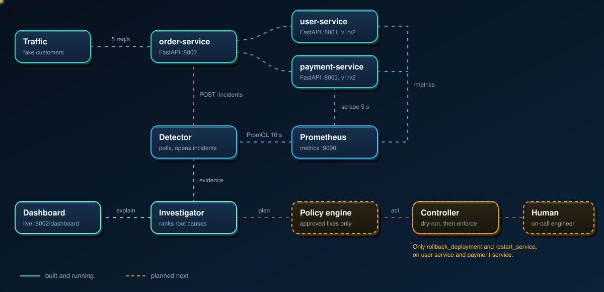
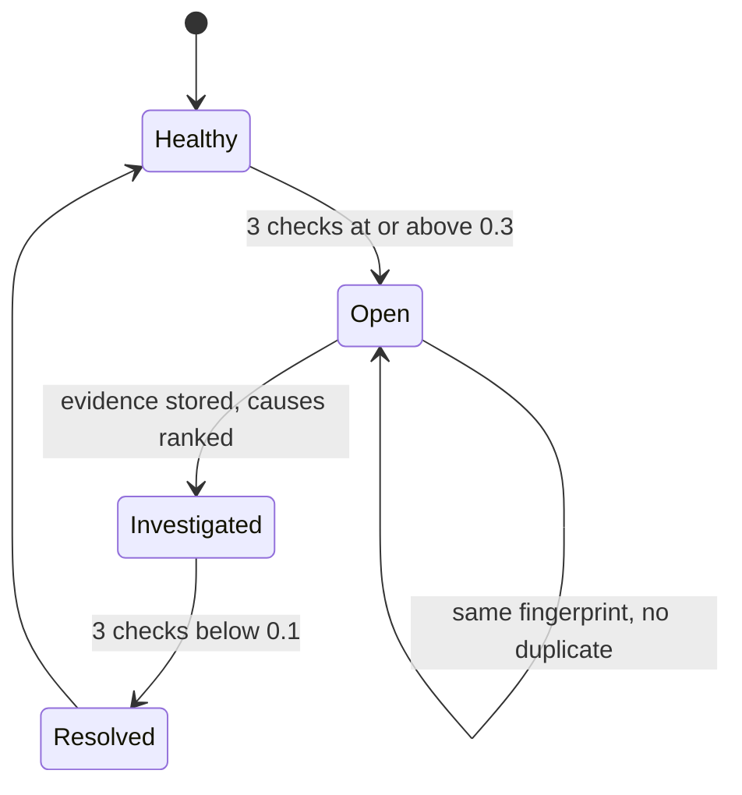

<p align="center">
  
</p>

<p align="center">
  
</p>

<p align="center">
  <a href="https://github.com/HemashreeVI/RootLens/actions/workflows/ci.yml"></a>
  
  
  
  
  
</p>

<p align="center">
  <b>RootLens watches a small microservice app, works out why it broke, and fixes it only within strict limits.</b>
</p>

---

## What it does

When a service fails, RootLens follows the same steps an on-call engineer would:

1. **Detect** the failure from live metrics.
2. **Collect evidence** (error rates, latency, which dependency is down or slow, recent deployments).
3. **Rank root causes** with a confidence level, instead of guessing one answer.
4. **Estimate impact** across the services that depend on the broken one.
5. **Pick an approved fix** (rollback or restart) through a restricted controller.
6. **Verify recovery**, and record every decision.
7. **Escalate to a human** when the evidence is not strong enough.

> The last two stages (policy engine and controller) are being built next. Everything from detection to ranked root causes, plus the release and rollback mechanics, already works. See the [roadmap](#roadmap).

## Architecture

<p align="center">
  
</p>

| Component | Port | Role |
|---|---|---|
| `user-service` | 8001 | FastAPI. Chaos switches for errors and latency. Release `v2` has a planted 4 s latency bug. |
| `order-service` | 8002 | FastAPI. Calls user then payment (3 s timeout each). Also hosts incidents, deployments, the investigator and the dashboard. |
| `payment-service` | 8003 | FastAPI. Same pattern. Release `v2` has a planted 50% error bug. |
| `detector` | none | Polls Prometheus every 10 s. Opens an incident after 3 checks at or above 0.3 failure ratio, resolves after 3 checks below 0.1. |
| `prometheus` | 9090 | Scrapes all three services every 5 s. |
| `grafana` | 3000 | "RootLens Observability Dashboard". |
| SQLite | volume | `/data/incidents.db` in the `rootlens-data` volume. Holds incidents and deployments. |

## How the investigator decides

For every dependency that is failing, the investigator scores three possible causes and reports them ranked, with the evidence for and against each.

| Cause | Main signals |
|---|---|
| **Down** | The `up` metric is 0, no metrics reported, most failures are "unreachable". |
| **Returning errors** | Service is up, its own error ratio is high, most failures are errors, p95 latency is normal. |
| **Too slow** | Service is up, most failures are timeouts, p95 latency is close to the caller's timeout. |

From Order's point of view, a dead dependency and a slow one both look like timeouts. The `up` metric is what tells them apart.

Confidence is **high** when the top score is at least 0.75 and leads the runner-up by 0.3 or more, **medium** when the top score is at least 0.5, and **low** otherwise. Below 0.4 the answer is "insufficient evidence". The output also names the root-cause service and the services it impacts.

## Incident lifecycle



## Quick start

You need Docker Desktop (WSL2), Git, Python 3 and PowerShell.

```powershell
git clone https://github.com/HemashreeVI/RootLens.git
cd RootLens
docker compose up -d
docker compose ps
```

You should see 6 containers running. Then open:

| What | URL |
|---|---|
| Live incident dashboard | http://localhost:8002/dashboard |
| Prometheus | http://localhost:9090 |
| Grafana | http://localhost:3000 |

> Never run `docker compose down -v`. It deletes the incident database volume.

## Try it: the failure lab

Use three terminals from the project root.

```powershell
# Terminal 1: watch the detector
docker compose logs -f detector

# Terminal 2: send fake customer traffic (about 5 requests per second)
python .\traffic.py

# Terminal 3: break something
Invoke-RestMethod -Method Post "http://localhost:8003/chaos/errors?rate=0.5"
```

Watch the dashboard. An incident opens after about 30 seconds. Then reset:

```powershell
Invoke-RestMethod -Method Post "http://localhost:8003/chaos/reset"
```

The detector log prints `RESOLVE incident` once traffic has been healthy for 3 checks. Wait about a minute before the next test so the 1-minute metrics window clears.

## Try it: bad release and rollback

Each service reads `SERVICE_VERSION` and exposes `/version`. Only `v2` contains a bug.

```powershell
.\deploy.ps1 payment-service v2   # bad release: 50% errors, incident opens
.\deploy.ps1 payment-service v1   # rollback: incident resolves
```

`deploy.ps1` updates `.env`, recreates only that container, waits for `/version`, then records the deployment through `POST /deployments`. If PowerShell blocks the script:

```powershell
powershell -ExecutionPolicy Bypass -File .\deploy.ps1 payment-service v2
```

## Tests and CI

```powershell
python .\order-service\test_investigator.py
```

Eight tests cover errors, slowness and outages for both dependencies, the older flat evidence format, and both dependencies failing at once. GitHub Actions runs two jobs on every push: `test` runs the unit tests, and `build` validates the compose file and builds every image.

## Project layout

```
RootLens/
├── assets/                  logo and animated diagrams used by this README
├── user-service/            FastAPI service with chaos switches
├── payment-service/         FastAPI service with chaos switches
├── order-service/
│   ├── app.py               API, incidents, deployments
│   ├── database.py          SQLite access
│   ├── investigator.py      root-cause ranking
│   ├── dashboard.py         live HTML dashboard
│   └── test_investigator.py unit tests
├── detector/                polls Prometheus, opens and resolves incidents
├── prometheus/prometheus.yml
├── compose.yaml
├── traffic.py               fake customers
├── deploy.ps1               versioned deploy and rollback
└── .github/workflows/ci.yml
```

## Roadmap

- [x] Three FastAPI services with Docker Compose
- [x] Prometheus and Grafana
- [x] Incident database with open and resolve lifecycle
- [x] Failure lab (chaos switches)
- [x] Continuous detector with evidence collection
- [x] Multi-service root-cause ranking with blast radius
- [x] Live dashboard
- [x] Unit tests and GitHub Actions CI
- [x] Versioned releases, `deploy.ps1`, deployment records
- [ ] Change correlation: flag a "bad release" cause when a failure starts soon after a deploy
- [ ] Policy engine: a unit-tested rule set that decides rollback, restart, or escalate
- [ ] Remediation controller: dry-run first, then enforce
- [ ] Dashboard: per-dependency evidence, deployments, escalations, audit log
- [ ] Later: LLM-written explanations grounded in evidence, OpenTelemetry traces, PostgreSQL, API authentication, Grafana persistence, Kubernetes, a latency-based detector, an experiment results table

## Safety design

The controller will need Docker access, which is powerful. These limits keep it contained:

- **Allowlist:** only `rollback_deployment` and `restart_service`, on `user-service` and `payment-service`.
- **Rate limits:** at most 2 actions per incident, 60 s apart, and 3 per service per hour.
- **Dry-run first:** the controller can be switched between `off`, `dry-run` and `enforce`.
- **Verify, then trust:** after acting, it checks that the failure ratio really dropped, and escalates if not.
- **Audit log:** every decision is recorded, including "chose not to act".
- **Human escalation:** medium or low confidence, or more than one dependency failing, means no action.

## Honest notes

- The rollback is real release mechanics, but the bug in `v2` is deliberately planted. This is a simulated release pipeline on one machine.
- `POST /deployments` is not authenticated yet.
- Slowness that stays under the 3 s timeout is not detected yet.

## Author

Built by **Hemashree** ([@HemashreeVI](https://github.com/HemashreeVI)) as a hands-on project in production reliability and AI-assisted operations.
